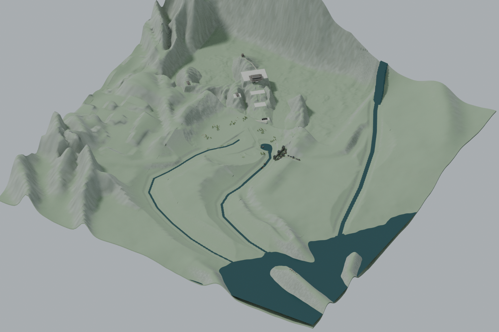
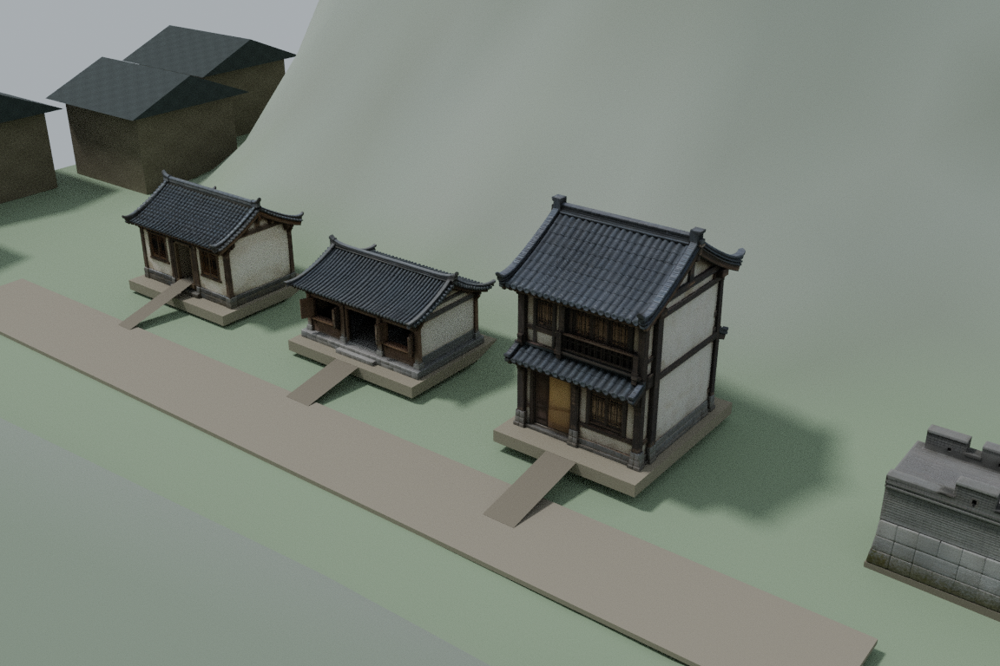
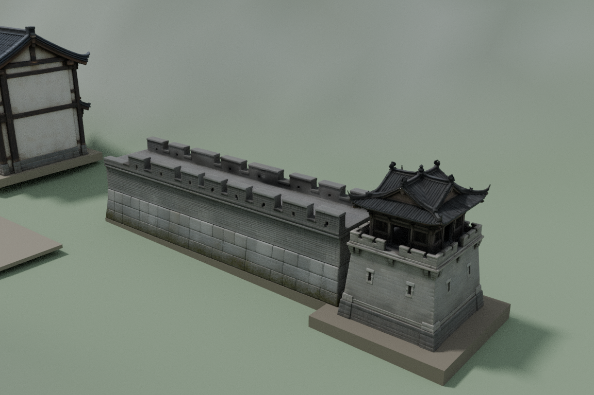
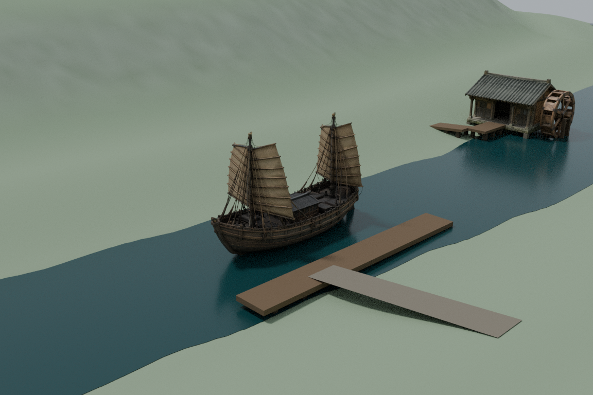
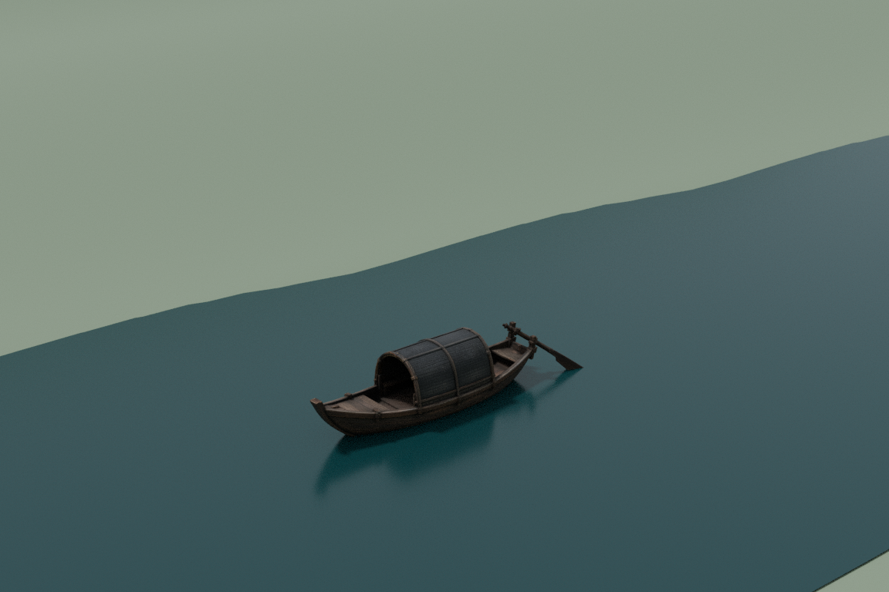
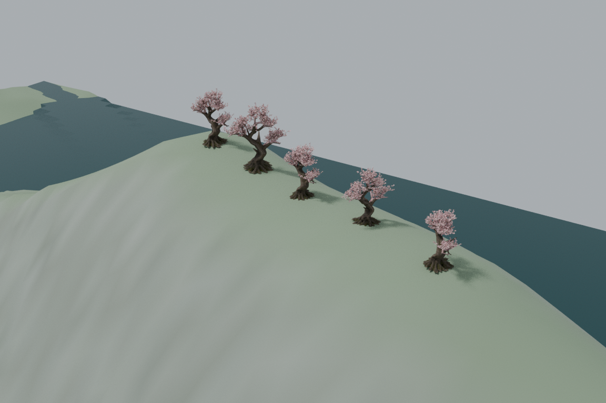

# 大世界新增八类资产 · 2026-10-18

原始8件模型已派生16个主版/LOD，树补上真实几何花叶；新增模型按C盆地布局接入独立Godot检查场景。未覆盖原主工程或本地另一版世界。

## 预览

以上都是Blender离线预览，非Godot实机截图或性能录像。详细实测范围见[RESULTS.md](RESULTS.md)。

## 下载

下载 [download_oct18.py](download_oct18.py) 和 [restore_verified_archive.py](restore_verified_archive.py)，放在同一文件夹。Python3运行：

`python download_oct18.py --ref FULL_COMMIT_SHA --group world --output restored_oct18`

FULL_COMMIT_SHA使用本PR已验证的资产提交（见后续UPLOAD_VERIFIED.json）。恢复默认只下载世界运行交付；`--group sources`下载原模型，`--group authoring`下载制作文件/原参考图，`--group all`下载全部。每块与整ZIP的SHA256、ZIP CRC及每个内部文件SHA256均核验。分卷不可单独解压。

恢复world之后运行：

`python restored_oct18/delivery/restore_oct18.py --output playable_oct18`

`python playable_oct18/run.py --view`

需要Godot4.6.3（支持--godot自定义路径）。旧世界和昨日4精修资产由内置恢复器按固定提交544d5b1035ac34bb76d6c9004c520c1ff34c2ffb读取，不重复上传。

## 归档与范围

- world_oct18：16个正式GLB、独立场景overlay、恢复器、检查脚本、QA及六张预览
- original_sources：用户上传8个原高模，仅归档一次；30附件实际29唯一分卷，029重复。没有缺卷
- authoring_oct18：可编辑桃花树master、修复脚本、校验记录、原C设计图及9参考图（09仅参考，未新增模型）

正式单层民居选择house_a_entry，封门对照版本不作正式交付。树master可编辑；制作脚本作为来源保留，其中旧工作路径需用[prepare_authoring_workspace.py](prepare_authoring_workspace.py)生成独立适配副本后再复现。原模型不删除。

## 已验与未验

最终独立恢复和Godot导入/运行成功；134段双向胶囊扫掠、1620支撑采样通过。船底与水面/河床关系另作几何检查。该范围不等于全地图通关、美术完全通过或游戏性能通过。

民居仅短门廊，双层屋/塔内部、墙顶连接及登船行动未开放验收。花岛用检查场景传送进入，尚无大陆到岛的桥路。场景不含人物动画、骑乘与NPC系统。云端C世界北为-Z，本地其他布局可能北为+Z，不能直接覆盖。

原生成资产的商业许可须按各平台条款单独确认；公开存储不代表许可范围已经确认。
