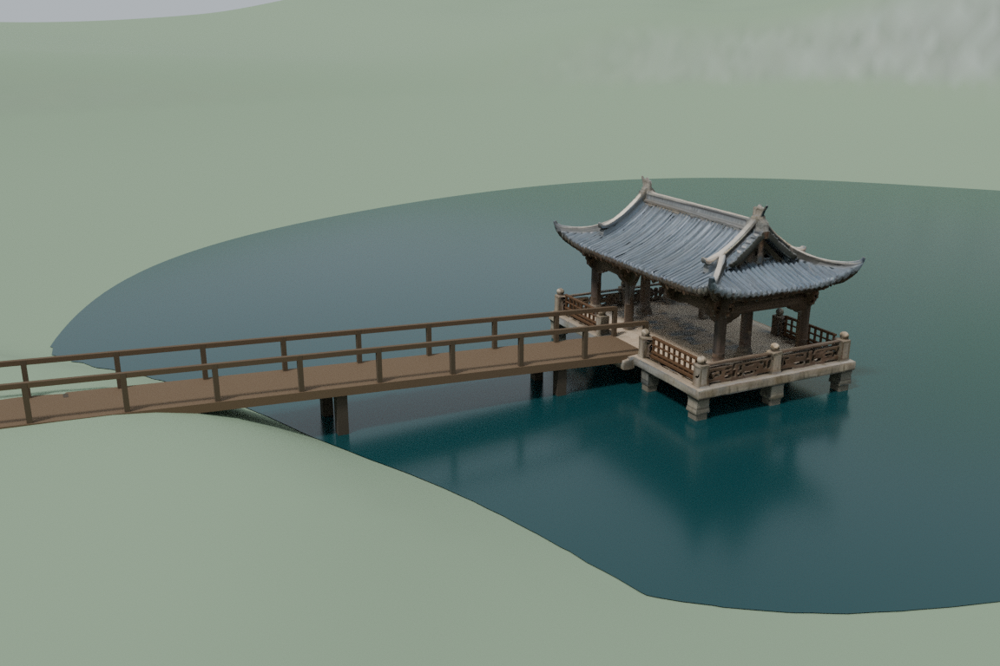
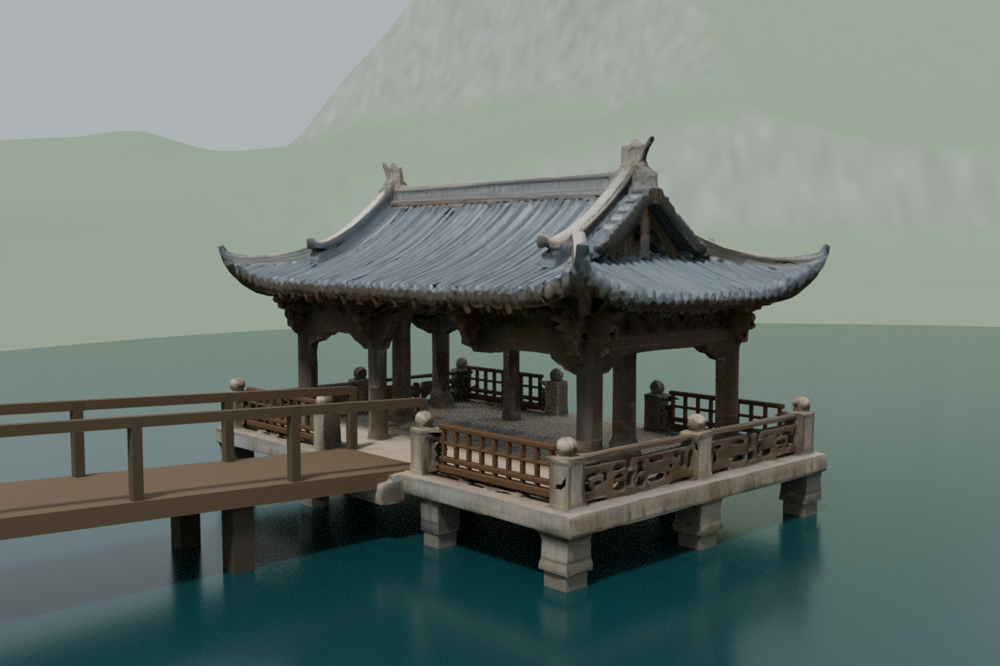
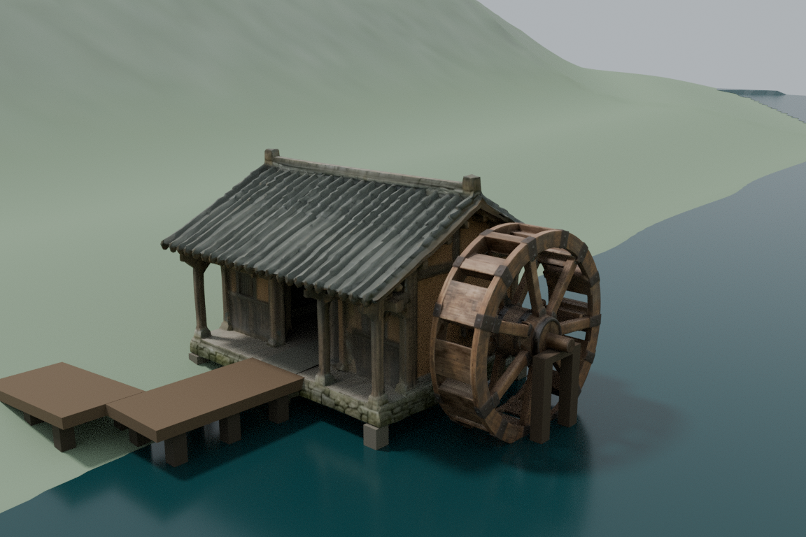
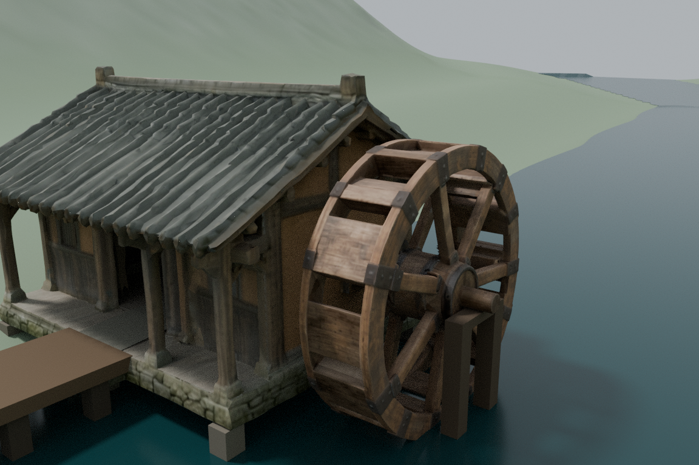

# 大世界 Lux3D 资产与精修落位预览 · 2026-10-17

本目录整体归档本轮 **20类资产**、源文件、参考图、精修结果、独立场景配置与可复现静态预览。请先按下面的恢复方式下载，分卷不能单独解压。未覆盖主世界、未合并分支、未重复打包旧人物。

## 看效果

[水轮完整一周4秒离线检查视频](previews/waterwheel_rotation.mp4)

全部为 **Blender离线预览**，不是Godot实机录像；自定义水面/地形材质有离线近似。轮转片是几何检查速度，不是正式运行速度。

## 下载和恢复

1. 下载本目录的 [restore_world_assets.py](restore_world_assets.py) 与 [bundle_index.json](bundle_index.json) 至同一个空文件夹
2. 在该文件夹运行：`python restore_world_assets.py --output restored_world_assets`
3. 脚本自动下载3个归档的全部192个分卷（合计约798MB）、验证每卷与整包SHA256、ZIP CRC和全部478个归档文件，然后解压到目标目录
4. 已下载且校验正确的分卷会复用。若已有目标文件内容不同，脚本停止，避免覆盖你的修改

只需特定分组时，可下载其全部同名前缀分卷，并按manifest顺序二进制拼接为ZIP。建议使用恢复脚本避免顺序或下载缺失。

- [Batch03原生生成资产清单](batch03_manifest.json)：16件GLB、16个源ZIP、16张参考图，以及生成参数/范围说明
- [精修与源文件清单](refined_assets_manifest.json)：山门、湖亭、粮仓、水轮源文件、最终GLB、作者脚本与纹理
- [世界预览清单](world_preview_manifest.json)：两个独立overlay、共享最小环境依赖、检查报告、最终媒体、portable启动器

## 当前完成范围

- 北山山门r02：材质精修并在A1独立替换预览，两个门洞空间检查保留
- 湖亭/粮仓/水轮r02：真实几何修补、材质处理、湖岸短桥与东溪装配；对应区域8条胶囊扫掠通过，141支撑采样命中
- Batch03：16次免费生成任务已完成并下载；源ZIP CRC及GLB嵌入PBR结构检查通过。尚未逐件美术、内部可探索、碰撞或世界落位验收
- 可移植湖区工程：重定位依赖导入与对应分区QA完成；北山静态入口脚本解析通过，未重新完成全北山运行检查

## 剩余限制

- 不等于所有建筑精修完成或整个大世界终验通过
- 某些原生模型仍有细节融合、栏杆/梁架粗糙等缺陷，具体记录见归档内报告
- 原主世界与用户本地另一版本世界布局不同；不直接用本包覆盖本地工程
- 共享依赖不包含旧人物和动画；不会提供完整人物骑乘游戏体验
- 云端完整场景重新导出受到内存限制，portable QA以对应分区为准；首次批量导入可能需要较多内存，可再次运行完成余下缓存
- Lux3D免费额度资产的商业授权仍需单独核实，归档公开不代表商业授权已经确认

## 使用工程

解压后阅读 `support/README.md`。Python3启动器将旧工作路径映射为独立runtime工程，Godot4.6.3用于静态检查/几何导出，Blender4.3.2用于离线渲染。原作者脚本作为制作来源保留，直接重跑作者脚本前需按自身目录调整其中旧路径。

远端回下载验证结果将在 `UPLOAD_VERIFIED.json` 记录。仅有Git blob/API成功不代表整包交付验证完成。
